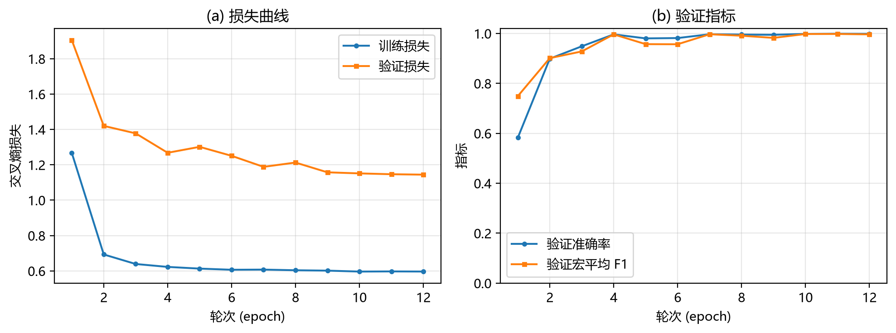
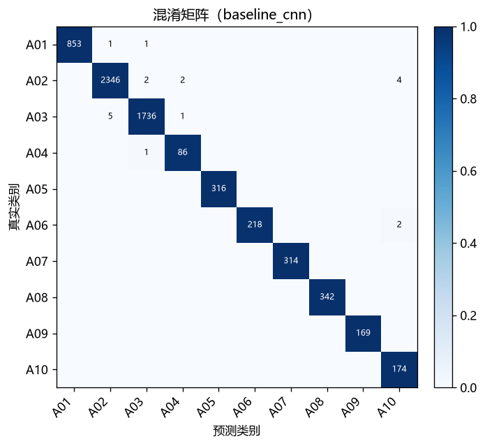
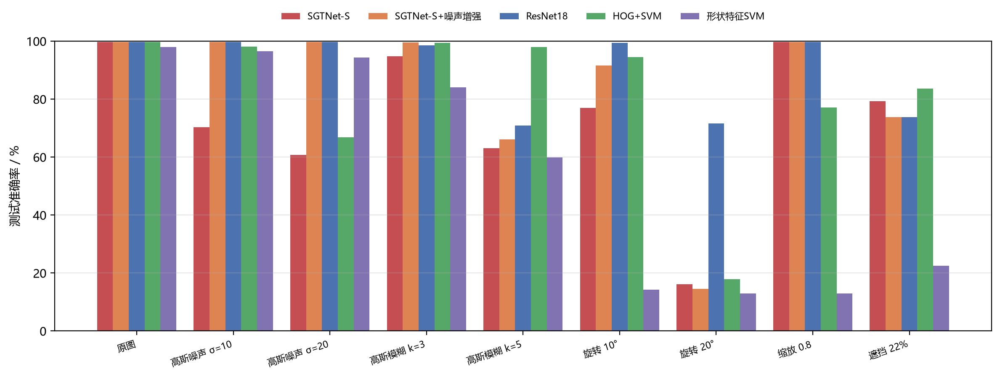
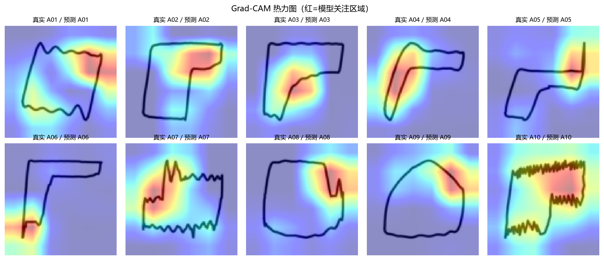

# 示功图工况分类（SGTNet-S）

《石油与人工智能》结课项目：把抽油机井的**示功图**（光杆载荷—位移闭合曲线）按形态分成 10 类（A01–A10），
用轻量卷积网络自动识别工况，并与 HOG+SVM、形状特征+SVM、像素+PCA+SVM、ResNet18 做系统对比。

- 输入：224×224 白底黑线轮廓图 → 96×96 灰度
- 模型：SGTNet-S，4 个卷积块 + 全局平均池化，**0.26 M 参数**
- 训练：纯 CPU（i5-13500H），12 轮约 15 分钟
- 测试：6573 张，**准确率 99.71%，宏平均 F1 0.9949**，单张推理 1.9 ms

## 结果

| 方法 | 参数量 | 训练耗时 | 单张推理 | 测试准确率 | 宏 F1 |
| --- | --- | --- | --- | --- | --- |
| ResNet18 | 11.17 M | 22.4 min | 3.00 ms | 99.77% | 0.9972 |
| HOG + 线性 SVM | — | 5 s | 0.01 ms | 99.77% | 0.9967 |
| 像素 + PCA + SVM | — | 3 s | 0.38 ms | 99.76% | 0.9968 |
| HOG + PCA + SVM | — | 3 s | 0.29 ms | 99.76% | 0.9953 |
| **SGTNet-S（本文）** | **0.26 M** | 15.4 min | 1.92 ms | **99.71%** | **0.9949** |
| 形状特征 + SVM | — | 1 s | 0.38 ms | 98.04% | 0.9890 |

在该数据集上精度已经饱和（各方法差异在统计误差内），真正的差异体现在鲁棒性上：

| 扰动 | SGTNet-S | SGTNet-S+噪声增强 | ResNet18 | HOG+SVM | 形状 SVM |
| --- | --- | --- | --- | --- | --- |
| 原图 | 99.71% | 99.71% | 99.77% | 99.77% | 98.04% |
| 高斯噪声 σ=10 | 70.38% | **99.73%** | 99.77% | 98.19% | 96.56% |
| 高斯噪声 σ=20 | 60.79% | **99.73%** | 99.76% | 66.83% | 94.34% |
| 高斯模糊 k=3 | 94.75% | 99.59% | 98.54% | 99.47% | 84.07% |
| 旋转 10° | 76.91% | 91.66% | 99.38% | 94.43% | 14.32% |
| 缩放 0.8 | 99.70% | 99.70% | 99.68% | 77.13% | 13.01% |
| 遮挡 22% | 79.28% | 73.83% | 73.82% | 83.57% | 22.56% |

结论：轻量 CNN 对噪声敏感，但加入噪声增强训练后，同样的 0.26 M 参数即可获得与 11 M 的 ResNet18 相当的抗噪能力，
而干净测试集上的准确率不受影响。

## 图









## 项目结构

```
src/
  config.py            路径与超参数
  prepare_data.py      JPG → npy 缓存
  data.py              数据扫描、增强、分层划分、类别权重
  models.py            SGTNet-S / ResNet18
  train.py             训练 + 验证 + 测试评估（支持消融开关）
  evaluate.py          对已有 checkpoint 做测试评估
  features.py          HOG / 形状特征 / 像素特征
  baseline_classic.py  传统方法基线
  robustness.py        噪声/模糊/旋转/缩放/遮挡鲁棒性实验
  robustness_extra.py  噪声增强模型的补充评估
  gradcam.py           Grad-CAM 可视化
  analyze_errors.py    错分样本分析
  eda.py               数据分布、样本图、理论示功图示意
  make_charts.py       对比/消融/鲁棒性统计图
  check_env.py         环境自检
data/cache/            npy 缓存（自动生成）
outputs/<tag>/         模型、指标、混淆矩阵
reports/fig/           报告用插图
```

## 复现

```bash
python -m venv .venv
.venv\Scripts\python.exe -m pip install -r requirements.txt
.venv\Scripts\python.exe -m pip install torch torchvision --index-url https://download.pytorch.org/whl/cpu
.venv\Scripts\python.exe src\prepare_data.py        # 首次：解码数据集
.venv\Scripts\python.exe src\train.py --epochs 12   # 训练 baseline
```

## 模型权重

训练好的权重发布在 [Releases v1.0.0](https://github.com/upc2026-cao/sgt-classification/releases/tag/v1.0.0)：

| 文件 | 说明 | 大小 |
| --- | --- | --- |
| `SGTNet-S_baseline.pt` | 主模型（0.26 M），测试准确率 99.71% | 1 MB |
| `SGTNet-S_noiseaug.pt` | 噪声增强版，σ=10 时 99.73% | 1 MB |
| `ResNet18.pt` | 11.17 M，测试准确率 99.77% | 43 MB |

下载后放到 `outputs/<tag>/best.pt`，运行 `python src/evaluate.py --tag <tag>` 即可复现测试集指标。

## 数据集

数据集由课程教师提供（10 类示功图图像，训练集 15322 张、测试集 6573 张），**未包含在本仓库中**。
默认路径为 `E:\石油与人工智能`，可用环境变量 `SGT_DATA_ROOT` 覆盖。

## 许可

MIT License，见 [LICENSE](LICENSE)。
